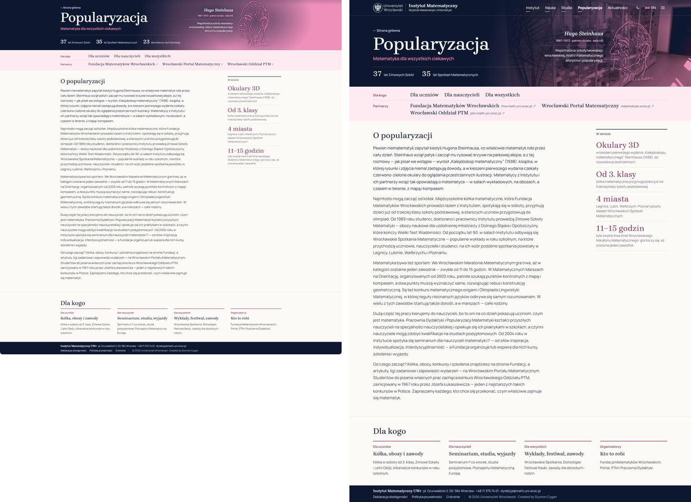
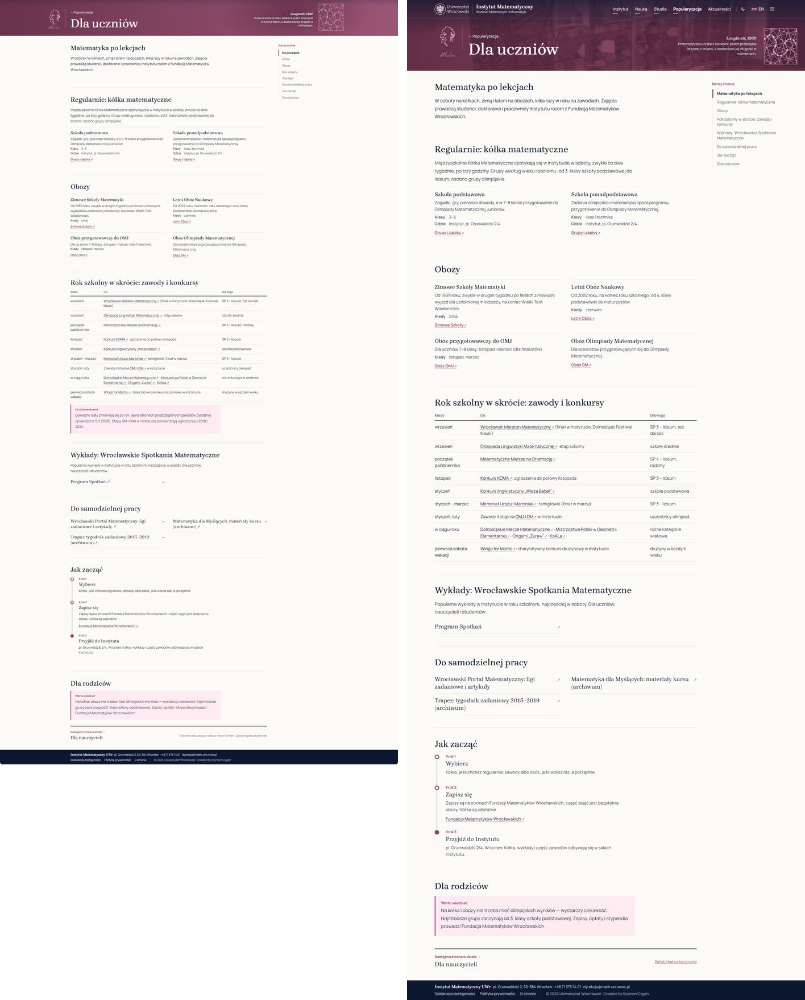
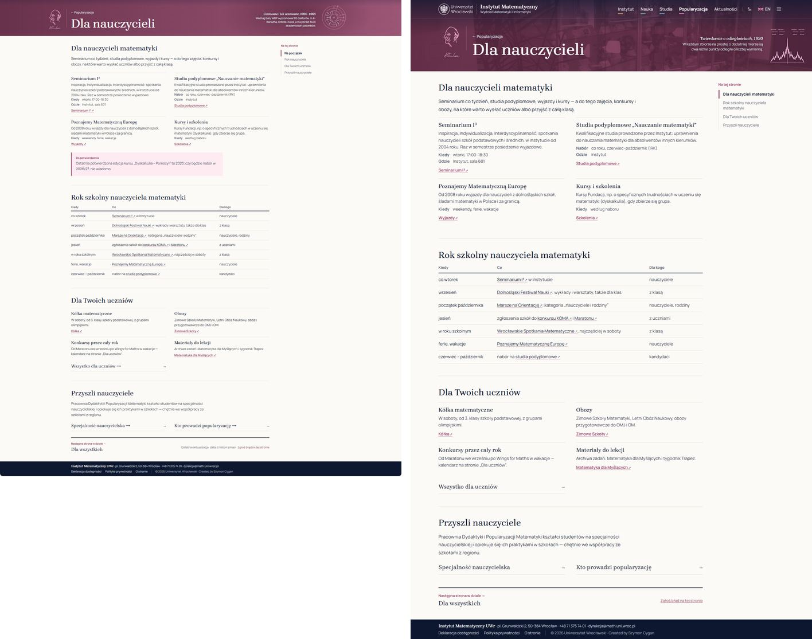
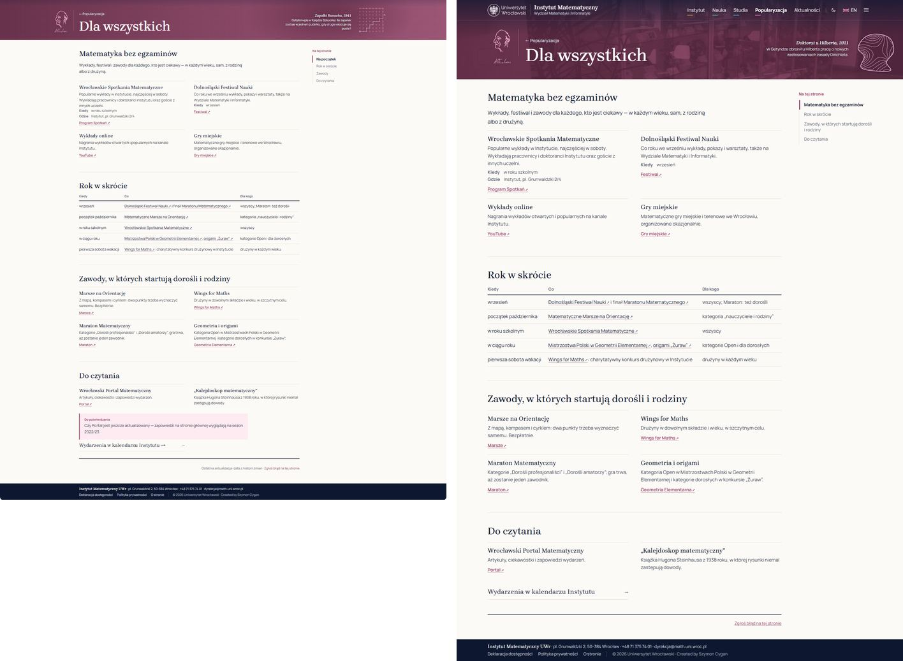
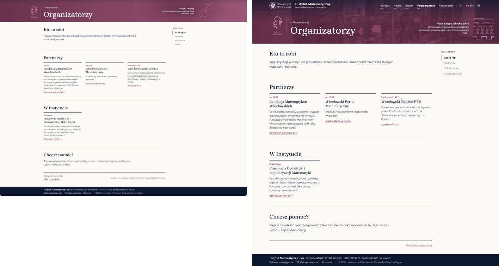

# Raport: zlecenie 15 — przebudowa Popularyzacji (5.11.2026)

Gałąź: `wyglad/zlecenie-15` (z ostatniego commita zlecenia 14), 6 commitów + commit raportu, **bez pushowania**. Zlecenie: `.przekazanie/zlecenia/15-popularyzacja.md`.

**Do Twojej decyzji albo działania**

1. **Łatki treści nałóż dopiero po sprawdzeniu sześciu punktów „Do potwierdzenia” (niżej).** Od punktu 1 (okulary 3D) zależy pierwsza pozycja „W skrócie” i zdanie w pierwszym akapicie, a od punktu 2 liczba w banerze.
2. **W banerze na komputerze są dwie liczby, nie trzy.** Trzecia („23 lata Marszy na Orientację”) nie mieści się o 9 px, więc znika według zasady z zalecenia 2. Telefon pokazuje wszystkie trzy. Zasady nie zmieniałem. Pytanie 1 niżej podaje dwa proste wyjścia.
3. **Tłumaczenie angielskie jest do przejrzenia** (terminy niżej).

Stan sprawdzenia:

- `astro build`: bez błędów i ostrzeżeń CSS.
- `astro check`: 6 błędów, **żaden nowy** (3 `process` w `astro.config.mjs`, 3 w `src/lib/zdjecia.ts` ze zlecenia 13).
- Treści: `skrypty/pobierz_tresci.py` nie był uruchamiany, repozytoriów Web-* nie zmieniałem. `package.json` bez zmian. **Nakładka zostaje zmieniona**, żebyś mógł obejrzeć wynik lokalnie (przywracanie niżej).
- Sprawdzane w Edge (Playwright) na zbudowanej stronie: 1440, 1920 i 390 px, jasny i ciemny motyw, PL i EN. Firefoksa, Safari, prawdziwych telefonów i czytnika ekranu nie sprawdzałem. Adresów zewnętrznych nie otwierałem: są przepisane z prototypu.

## Podsumowanie

| Punkt | Stan | Commit |
|---|---|---|
| 1. Dane i formularz CMS | zrobione, jako łatka | `f04cc238` |
| 2. Strona działu | zrobione | `af3929a6` |
| 3. Menu działu i hamburger | zrobione | `b7e60cc3` |
| 4. Cztery podstrony | zrobione, z poprawką | `9802df07`, `d609bd87` |
| 5. Wersja angielska | zrobione, do przejrzenia | `7b081278` |
| 6. Do potwierdzenia | lista niżej | ten commit |

## Kryteria odbioru

| Kryterium | Wynik |
|---|---|
| Strona działu i cztery podstrony jak w prototypie, PL i EN | zrzuty obok siebie niżej; różnice opisane |
| Bez „To be announced” i liczb „TBA” | sprawdzone na `/popularyzacja` i `/en/popularyzacja`, komputer i telefon |
| Hasło na okładce, w banerze, w menu telefonu | „Matematyka dla wszystkich ciekawych” / „Mathematics for the curious” odczytane ze strony w każdym z tych miejsc |
| Menu działu, panel, „Następna strona” bez Organizatorów | sprawdzone; „Następna strona”: Dla uczniów → Dla nauczycieli → Dla wszystkich, tam koniec, bo partnerzy to linki zewnętrzne |
| Do Organizatorów prowadzą karta i link | karta „Dla kogo” i link „Kto prowadzi popularyzację” na stronie Dla nauczycieli |
| Łatki z opisem, kopia oryginałów | `dok/latki/zlecenie-15/` z `README.md`; `.przekazanie/robocze/nakladka-przed-15/` |
| Linki z `POP_U` | wszystkie 31 adresów jest na stronach albo w menu; bez `target="_blank"`; ↗ dochodzi samo |

## Prototyp i strona obok siebie (1440 px)

Z lewej prototyp, z prawej zbudowana strona.

Strona działu:



Dla uczniów:



Dla nauczycieli:



Dla wszystkich:



Organizatorzy:



Pozostałe zrzuty:

- [Wersja angielska, 1440 px](raport-zrzuty/z15-en-1440.jpg)
- [Telefon, 390 px, PL i EN, jasny i ciemny](raport-zrzuty/z15-telefon-390.jpg)
- [Ciemny motyw, 1920 px](raport-zrzuty/z15-ciemny-1920.jpg)
- [Panel hamburgera, komputer](raport-zrzuty/z15-panel-1440.jpg)
- [Panel hamburgera, telefon, PL i EN](raport-zrzuty/z15-panel-telefon-390.jpg)

**Różnice wobec prototypu**

| Miejsce | Prototyp | Strona | Dlaczego |
|---|---|---|---|
| Liczby w banerze na komputerze | trzy | dwie | zasada z zalecenia 2 (pytanie 1) |
| Wiersz „Partnerzy” | bez domen | z domeną jako podpisem | polecenie w punkcie 3 zlecenia („jak dziś”) |
| Spis „Na tej stronie” | krótkie etykiety („Kółka”, „Rok szkolny”) | pełne nagłówki `##` | spis bierze tekst nagłówka, Markdown nie ma pola na krótką etykietę |
| Strony Organizatorzy | „Następna strona: Dla uczniów” | tylko „Zgłoś błąd” | Organizatorów nie ma w menu, więc nie ma też kolejnej strony |
| Listy linków | dwie strzałki (→ i ↗) | jedna, ↗ albo → | zalecenie 23 |
| Stopka podstrony | „Ostatnia aktualizacja: data z historii zmian” | bez daty | strona nie zna tej daty, jak na innych podstronach |
| Ramki „Do potwierdzenia” | na stronie | w tym raporcie | polecenie w zleceniu |

## Co zostało zrobione

**1. Dane i formularz.** `src/data/popularyzacja.json` ma pola `haslo`, `wstep`, `o_popularyzacji`, `o_popularyzacji_fakty` i `tradycja`, z wersjami EN. Literówki „,,” z zlecenia nie ma już w tekście prototypu, więc nie było czego poprawiać: tekst ma „w roku szkolnym, na które”. Pole `grupy` zniknęło z danych i z formularza. Pole `linki` zostało w formularzu i w danych, choć widok go nie czyta, bo zlecenie o nim nie wspomina.

**2. Strona działu.** Baner z hasłem i latami tradycji liczonymi przy budowie, blok `TrescDzialu` z „O popularyzacji” i „W skrócie”, karty „Dla kogo” z nagłówków stron. Nowa strona w katalogu sama dostaje kartę. W `src/lib/patroni.ts` poprawione hasło zapasowe.

**3. Menu.** `TrescDzialu.astro` ma jeden układ wierszy dla wszystkich działów. Usunąłem style dawnego układu Popularyzacji i sekcji „To be announced”. Na telefonie długie nazwy partnerów łamią się, bo inaczej rozciągały stronę do 574 px.

**4. Podstrony.** Treść 1:1 z `trescPop()`, adresy z `POP_U`. Wewnętrzne adresy z prototypu (tam `href="#"`):

- „Specjalność nauczycielska” → `/studia/matematyka/matematyka-nauczycielska`
- „Wydarzenia w kalendarzu Instytutu” → `/kalendarz`
- „Struktura i zakłady” → `/instytut/struktura`

**Blok bez odpowiednika.** Zlecenie każe użyć konstrukcji Markdown ze stron przeniesionych na wzorzec, ale te strony nie mają w Markdownie dwóch kolumn, kontaktów ani etapów. To są elementy widoków, a edytor Pages CMS (rich-text) nie przepuszcza surowego HTML. Dlatego dodałem pole `bloki` i wtyczkę `src/plugins/rehype-bloki.mjs`, która rozpoznaje blok po budowie listy. Budowa list jest w `.przekazanie/pola-do-cms.md`. Strony bez `bloki: true` renderują się po staremu. Formularz „Strony Popularyzacji” jest w łatce, ale nie sprawdzałem go w samym Pages CMS. Nie wiem więc, czy edytor zachowa listy z kilkoma akapitami w pozycji po zapisaniu.

**Strona Organizatorzy** jest poza menu, więc `strona.ts` przypisuje ją do działu po adresie. Dzięki temu działa „← Popularyzacja” i znak z ciekawostką. W stopce ma tylko „Zgłoś błąd”.

**Ciekawostki.** Pole `podstrona` nie steruje dziś losowaniem: `src/lib/ciekawostki.ts` traktuje je jako pole przeglądowe, więc na podstronie pokazuje się losowa ciekawostka z puli działu, jak w innych działach (zalecenie 19). Nazwy `podstrona` są zgodne z `tytul` stron.

**Drobiazgi poza punktami.** `.gitignore` pomija teraz `src/content/strony/popularyzacja/` i `src/content/strony/o-stronie.md` (to drugie przeoczyłem w zleceniu 14). Oba pliki leżą w repozytoriach treści.

## Do potwierdzenia (treść łatki od tego zależy)

Źródła: `popularyzacja/inwentarz/INWENTARZ.md` (spis) i `popularyzacja/tekst/TEKST.md` (tekst agenta), gałąź `origin/kopia/2026-11-01-estetyka-prototypy`.

| # | Co sprawdzić | Co mówi źródło | Miejsce w treści |
|---|---|---|---|
| 1 | Czy czerwono-zielone okulary były w kieszeni **polskiego** pierwszego wydania „Kalejdoskopu” (1938) | `TEKST.md`, wątpliwość 1 i źródła: Linda Hall Library opisuje je dla *Mathematical Snapshots* z 1938 r.; dla polskiego wydania niepotwierdzone. Najprościej sprawdzić egzemplarz w bibliotece | „W skrócie”: „Okulary 3D”; pierwszy akapit „O popularyzacji”, PL i EN |
| 2 | Wrocławskie Spotkania Matematyczne: 1991 czy 1993 | `INWENTARZ.md`, sekcja Spotkań: 1991 wg strony cyklu, 1993 wg historii FMW. `TEKST.md`, wątpliwość 5: obie daty mogą być prawdziwe | `tradycja`: „35 lat Spotkań Matematycznych” w banerze; „od początku lat 90.” w drugim akapicie |
| 3 | Seminarium I³: czy działa i czy „co wtorek” | `INWENTARZ.md`: wtorki 17:00–18:30, sala 601, zapowiedź wyjazdowa XI 2026. `TEKST.md`, wątpliwość 3: statystyka strony kończy się na 2018/19, ostatnie znalezione posiedzenie 15.12.2022 | karta Dla nauczycieli; `nauczyciele.md`: pierwsza pozycja i kalendarz „co wtorek”; czwarty akapit |
| 4 | Kurs „Dyskalkulia – Pomocy!”: czy będzie nabór w 2026/27 | `INWENTARZ.md`, tabela kursów: ostatnia opisana edycja VI, wiosna 2023 | `nauczyciele.md`: „Kursy i szkolenia” |
| 5 | Wrocławski Portal Matematyczny: czy jest aktualizowany | `INWENTARZ.md`, sekcja Portalu: zapowiedzi wyglądają na sezon 2022/23; podstrony blokują roboty | piąty akapit; `uczniowie.md` „Do samodzielnej pracy”; `wszyscy.md` „Do czytania”; `organizatorzy.md`; menu |
| 6 | Daty zawodów (stan z 5.11.2026); etapy OM i OMJ w Instytucie | `INWENTARZ.md`, sekcja OM i OMJ: ogłoszenia IM z 12.01.2019 (OMJ) i 9–10.02.2024 (OM) | kalendarze w `uczniowie.md`, `nauczyciele.md`, `wszyscy.md` |

Z `TEKST.md` warto też sprawdzić wątpliwość 4: w harmonogramie 2025/26 Spotkania nie są comiesięczne. Tekst na stronie mówi tylko „w roku szkolnym”, więc nic nie trzeba zmieniać.

## Łatki i nakładka

- `dok/latki/zlecenie-15/Web-Popularyzacja.patch`: dane działu, cztery strony, `.pages.yml`.
- `dok/latki/zlecenie-15/Web-Ustawienia.patch`: grupa „Dla kogo” w menu.
- Repozytoria ustalone z zawartości klonów: `popularyzacja.json` w Web-Popularyzacja, `nawigacja.json` w Web-Ustawienia. Obie łatki przechodzą `git apply --check` na czystych klonach.

Przywrócenie nakładki (z katalogu Web-Core):

```bash
cp .przekazanie/robocze/nakladka-przed-15/src/data/popularyzacja.json src/data/popularyzacja.json
```

```bash
cp .przekazanie/robocze/nakladka-przed-15/src/data/nawigacja.json src/data/nawigacja.json
```

```bash
rm -r src/content/strony/popularyzacja
```

## Tłumaczenie: terminy do przejrzenia

Zgodnie ze zleceniem polskie nazwy własne zostają, a w nawiasie jest objaśnienie po angielsku. Wahałem się przy:

| Polski | Angielski | Wątpliwość |
|---|---|---|
| Popularyzacja | Outreach | nazwa działu z menu; „popularisation” brzmi obco |
| uczniowie | pupils | „students” myliłoby się ze studentami |
| 3. klasa | year 3 | brytyjski system klas zamiast „3rd grade” |
| kółka matematyczne | maths circles | „maths” brytyjskie, w tekście też „mathematics” |
| Zimowe Szkoły Matematyki | Winter Schools of Mathematics | w banerze „Winter Schools” bez polskiej nazwy, jak w przykładzie ze zlecenia |
| Wielki Test Wiadomości | Great Knowledge Test | dosłownie |
| Letni Obóz Naukowy | Summer Science Camp | „science” szersze niż matematyka |
| Wrocławskie Spotkania Matematyczne | Wrocław Mathematical Meetings | w banerze „Mathematical Meetings” |
| Matematyczne Marsze na Orientację | Mathematical Orienteering Marches | „marches” dosłownie; może „orienteering events” |
| Dolnośląskie Mecze Matematyczne | Lower Silesian Maths Matches | dosłownie |
| Poznajemy Matematyczną Europę | Discovering Mathematical Europe | mój przekład, bez oficjalnej nazwy |
| Matematyka dla Myślących | Mathematics for Thinkers | mój przekład |
| „Kalejdoskop matematyczny” | “Mathematical Snapshots” | angielski tytuł książki, wydanie 1938 |
| Pracownia Dydaktyki i Popularyzacji Matematyki | Laboratory of Mathematics Education and Outreach | oficjalna angielska nazwa nieznana |
| Fundacja Matematyków Wrocławskich | Wrocław Mathematicians Foundation | w menu (istniejące pole) sama nazwa angielska |
| kategoria „Dorośli profesjonaliści / amatorzy” | “professional / amateur adults” | dosłownie |
| studia kwalifikacyjne | qualifying studies, “a licence to teach” | polskie „uprawnienia” bez dobrego odpowiednika |

## Pytania

1. **Trzecia liczba w banerze.** Wiersz ma 680 px, trzy liczby zajmują 689 px (po angielsku 767 px). Wyjścia: krótsza nazwa „Spotkań” zamiast „Spotkań Matematycznych” w danych (zmieści się po polsku, po angielsku trzeba by skrócić więcej) albo mniejszy odstęp między liczbami z 34 do 29 px na wszystkich działach (też tylko po polsku). Zostawiłem dwie liczby. Kolejność decyduje, co znika: dziś „Marsze”.
2. **Krótkie etykiety w spisie „Na tej stronie”.** W prototypie są („Kółka”, „Rok szkolny”). Wymagałyby nowego pola albo umowy w Markdownie. Długie nagłówki łamią się na dwie linie, ale działają. Dodawać?
3. **Edytor Pages CMS a bloki.** Warto zapisać jedną stronę w prawdziwym formularzu, zanim redaktorzy zaczną z niego korzystać. Jeśli edytor rozsypie listy, strona wróci do zwykłych list z kreskami, bez utraty treści.
4. **Pole `linki` w formularzu Popularyzacji.** Widok go nie czyta. Usunąć w następnej łatce?
5. **Pole `podstrona` w ciekawostkach.** Zostawiam przeglądowe, jak w innych działach. Czy ciekawostki mają się losować tylko spośród przypisanych do danej podstrony?
